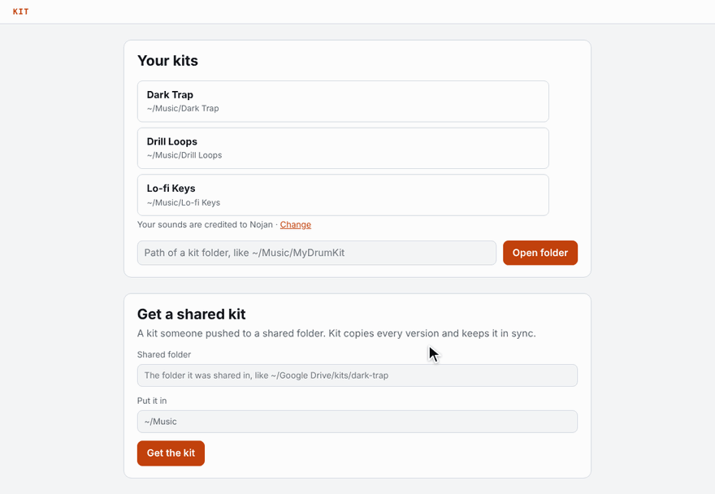

# Kit

[](https://github.com/nojanpourjafar/kit-vcs/actions/workflows/tests.yml)

Git-style version control for sample packs and loop kits.



Keep your kit folder exactly as it is. `kit` remembers every version of it, shows what changed between versions, rolls back, shares the kit with other producers, merges their changes into yours, and records who added each sound.

## Why

Producers share kits as zip files, so every update is a new zip and nobody can tell what changed. Kit gives a kit folder a real history: small, readable versions in place of `MyKit_v3_FINAL.zip`, updates that send only the new sounds, and credits that survive renames and collaboration.

## Download

The app is on the [releases page](https://github.com/nojanpourjafar/kit-vcs/releases/latest): `Kit-macOS.zip` for Macs with Apple Silicon, `Kit-Windows.zip` for Windows. Unzip it and open Kit; nothing else needs installing.

The app is not signed yet, so the system warns the first time:

- **macOS:** if it says Kit cannot be opened, go to System Settings > Privacy & Security and click Open Anyway.
- **Windows:** if SmartScreen appears, click More info, then Run anyway.

When a newer version is out, Kit says so at the top of the window, with a button that opens this page. To update, download it and replace the old app; kits, history and settings are kept outside the app and carry over. To find out, Kit asks GitHub for the number of the latest release, at most once a day; nothing else is sent. Set `KIT_NO_UPDATE_CHECK=1` to turn this off.

If something goes wrong, **Report a problem** at the bottom of the All kits screen shows a short report to copy into a message: the Kit version, the system, and the last errors Kit recorded (in `kit.log`, in the app's settings folder). Nothing is sent from Kit itself.

## Install

Needs Python 3.10 or newer. No other dependencies.

```
git clone https://github.com/nojanpourjafar/kit-vcs.git
cd kit-vcs
pip install -e .
```

This gives you the `kit` command. To run it without installing, use `PYTHONPATH=src python -m kit ...` in place of `kit ...`.

## Quick start

```
python examples/make_demo_kit.py demo_kit    # 4 synthesized sounds to try it on
cd demo_kit

kit init --author "Nojan"
kit commit -m "first four sounds"

mv Kicks/kick_punch.wav Kicks/kick_01.wav    # rename a sample
kit status                                   # > Kicks/kick_01.wav  (was Kicks/kick_punch.wav)
kit commit -m "renamed the kick"             # Stored 0 new file(s), 0 bytes.

kit log                                      # v2, v1
kit diff v1 v2
kit restore v1                               # folder goes back; history stays
kit credits                                  # who first added each sound
kit show                                     # opens the version as a web page
```

## The app

If you would rather click than type, run this inside a kit folder:

```
kit ui
```

It opens Kit in your browser. The folder's sounds are listed with waveforms and play buttons, unsaved changes are marked, and there are buttons to save a version, look at or go back to an older one, and push and pull. Everything runs on your own computer: `kit ui` starts a small server that only your machine can reach, and stops when you press Ctrl+C in the terminal.

`kit ui` works on one folder. The **All kits** button at the top leads to a home screen that lists the kits opened before, so you can switch between them. The × beside a kit takes it off the list; the folder itself is not touched.

A modified sound has a **Before** button that plays its previous version from the same point, to hear what changed; it works for unsaved edits and for every saved version. The ↗ button on each sound shows the file in Finder (Explorer on Windows), ready to drag into FL Studio or any other program. In `kit app`, sounds can also be dragged straight out of the window into FL Studio or any other program, on macOS and Windows. The search box above the sounds (press `/` to jump to it, Esc to clear) filters them by name; every word typed must appear, so `kick 808` finds `808s/Kick 808.wav`. Tempo and key are read from file names (`Dark Loop 140bpm F#m.wav` shows as 140 BPM, F# min) and can be searched too: `140`, `f#m` or `f# minor`. Loops whose names give no tempo get one estimated from the audio, shown as `≈140 BPM`, melodic loops whose names give no key get one from the audio, shown as `≈F# min` and searchable like a key in a name, and one-shots whose names give no key get the note they play, shown as `≈F#`, so an 808 can be matched to the key of a song; see below for how reliable both are. From the keyboard: ↑ and ↓ choose a sound, Space plays or pauses it, S stars it, and Enter in the search box plays the first match.

**Loops at [140] BPM**, beside the search box, plays every loop whose tempo Kit knows (from its name, or heard) sped up or slowed down to that tempo at the same pitch, repeating, so loops from different packs can be heard together before they go into a project. A loop at about half or double the tempo plays in half or double time instead of being stretched that far; one-shots play as they are. The speed change is the web view's own (the audio element's playback rate with pitch kept), which is quick but can smear sharp hits when the change is large. The tempo is remembered; empty it to play everything as it is.

The ✂ on a loop cuts it into one-shots: each hit becomes its own WAV file, in the loop's format, in a folder beside it ("Groove chops/Groove 01.wav", ...), ready to save as new sounds.

Buttons above the sounds (All · Kick · 808 · Snare · Clap · Hat · Perc · Melodic · Loop, each with a count) show one kind at a time, together with the search and ★ Starred. Kinds come from names, and sounds whose names say nothing are listened to in the background when a kit is opened or saved (see `kit kinds` below); their buttons fill in when that is done.

The ✎ on each sound (or N) writes a short note on it, like "use for the hook", shown under the sound with who wrote it, and searchable. Notes are shared: push and pull carry them, and when two people changed the same note, the later change wins. `kit note <path> "text"` and `kit notes` do the same in the terminal.

**Split sheet**, beside the export button, saves a PDF for a version: each person's sounds (credited to whoever first added the audio, even after renames), a share for each person by number of sounds, and a line for each to write the agreed share and sign. When a beat made with the kit is placed, that is the record of who made what. The PDF is written by Kit's own small PDF writer (`pdf.py`), in Helvetica, and the same version always gives the same file.

The ☆ on each sound stars it, and **★ Starred** beside the search box shows only the starred ones. Stars are yours alone: they stay in your copy of the kit and are never pushed.

A saved version is shown compared with the one before it. The **Compared with** box picks any older version instead, and the badges, the list of removed sounds and the Before buttons all follow, so it shows everything that changed since, say, the version you last sent someone.

To have Kit in its own window, the way a desktop app looks, install one extra package and use `kit app`:

```
pip install -e ".[app]"
kit app
```

It starts on the home screen, with a button that opens the system's folder chooser. The home screen also has **Get a shared kit**: choose the folder a kit was shared in (a Google Drive or Dropbox folder, say) and where to put your copy, and Kit clones it; no Terminal needed. The window is the same page as `kit ui`, shown by [pywebview](https://pywebview.flowrl.com/) in the system's built-in web view, so no browser is bundled. `kit app --browser`, or running it without pywebview installed, uses the browser instead.

### A double-click app

`packaging/build_app.py` turns Kit into an app that needs no Terminal and no Python on the computer that runs it:

```
pip install -e ".[app]" pyinstaller
python packaging/build_app.py
```

The result is `dist/Kit.app` on macOS and `dist/Kit/Kit.exe` on Windows. Pushing a version tag (`git tag v0.4.0 && git push --tags`) makes GitHub build both and publish them as a release (`.github/workflows/release.yml`). PyInstaller builds for the system it runs on, so the Windows app has to be built on Windows. The app is not signed: the first time it is opened on another Mac, macOS will refuse until it is allowed under System Settings > Privacy & Security.

## Sharing a kit

A remote is anywhere a copy of the history can live. The simplest one is a folder: a USB drive, or a folder synced by Google Drive or Dropbox.

```
kit push ~/GoogleDrive/shared-kit            # send your versions; the remote is remembered
kit push                                     # later pushes send only what is new
```

Someone else gets their own copy, which is also how a pack is forked:

```
kit clone ~/GoogleDrive/shared-kit my-copy --author "Lucas"
cd my-copy
# add or change sounds, then:
kit commit -m "added an open hat"
kit push
```

And you bring their work into yours:

```
kit pull
```

If both of you saved new versions since you last synced, `kit pull` merges the two histories. Sounds changed on only one side are taken as they are. If you both changed the same sound, nothing is thrown away: your file stays, and theirs is saved beside it as `name (from Lucas).wav`. The app shows the two side by side to listen to, with Keep mine, Keep theirs and Keep both; on the command line, `kit status` lists them and `kit resolve <path> --keep mine|theirs|both` settles one. Then save a version to share the choice. `kit credits` then shows who added what, with a split by number of sounds.

### Cloud storage

A remote can also be a bucket on Amazon S3 or an S3-compatible service such as Cloudflare R2:

```
pip install boto3
kit push s3://my-bucket/my-kit
```

Credentials are read from the usual AWS environment variables or `~/.aws/credentials`. For a non-Amazon service, set `KIT_S3_ENDPOINT` to its URL. The S3 remote is tested against an in-memory S3 imitation (moto); it has not yet been run against a real bucket.

## Commands

| Command | What it does |
|---|---|
| `kit init` | Start tracking the current folder |
| `kit status` | Show what changed since the last version |
| `kit commit -m "message"` | Save the folder as a new version |
| `kit log` | List saved versions, newest first |
| `kit diff v1 v2` | Show what changed between two versions |
| `kit restore v1` | Put the folder back to an earlier version |
| `kit credits` | Show who first added each sound, and the split |
| `kit name v3 1.0` | Give a version a name; names work anywhere a version does (`kit export 1.0`) |
| `kit names` | List the names given to versions |
| `kit author [name]` | Show or change the producer name new versions are credited to |
| `kit ui` | Open Kit as an app in your browser |
| `kit app [folder]` | Open Kit in its own window, starting on the list of your kits |
| `kit show [v2]` | Write a version out as a single web page you can send to someone |
| `kit chop <loop>` | Cut a loop into one-shots, one file per hit, in a folder beside it |
| `kit kinds [kind]` | Sort the sounds into kicks, 808s, snares, claps, hats, percs, melodic and loops |
| `kit dupes [kits...]` | Find sounds that are in more than one place, even renamed, re-bounced or converted |
| `kit splits [v2]` | Save a split sheet (PDF): who added which sounds, a share for each person, and lines to sign |
| `kit export [v2]` | Save a version as a plain zip next to the kit, for people who do not use Kit |
| `kit remote [where]` | Show or set the default remote |
| `kit push [where]` | Send new versions to a remote |
| `kit pull [where]` | Get new versions from a remote, merging if needed |
| `kit resolve <path> --keep mine\|theirs\|both` | Settle a sound both sides changed |
| `kit clone <where> [folder]` | Make a new kit folder from a remote |
| `kit verify` | Check that nothing stored is damaged or missing |
| `kit note <path> ["text"]` | Show, write, or clear (with `""`) the note on a sound; `kit notes` lists them |
| `kit compact` | Store saved WAV files as FLAC inside `.kit`, in about half the space |

Versions can be named as `v1`, `v2`, ..., as `latest`, by a name given with `kit name` ("1.0", "Sold on BeatStars"), or by the start of their ID. `where` is a folder path or `s3://bucket/prefix`.

A `.kitignore` file in the kit folder lists things to leave out, one pattern per line: `*.asd` for a file type, `Drafts/` for a folder.

## How it works

**Every file is stored once, under the name of its own hash.**
Each file is run through SHA-256 and saved as `.kit/objects/<hash>`. The same kick in ten versions takes the space of one kick. Renaming or moving a sample stores nothing, because the audio, and so the hash, did not change.

**A version is a list of "path -> hash", called a manifest.**
It holds no audio, so it is tiny. Comparing two manifests gives the changes: a new path is an addition, a new hash at the same path is a modification, and a hash that moved to a new path is a rename.

**Versions form a chain.**
Each commit is a few lines of JSON: its manifest, author, message, time, and the ID of the version before it. `HEAD` holds the ID of the latest one. A commit's ID is the hash of its own JSON, so an edited old version no longer matches its ID and is caught. A merge is a commit with two parents.

```
MyKit/
  Kicks/kick_01.wav ...       your sounds, untouched
  .kit/
    objects/ab/cdef...        every file ever saved, named by hash
    commits/<id>.json         one small file per version
    HEAD                      ID of the latest version
    config.json               author name and default remote
    index.json                cache of file hashes
    stars.json                your starred sounds (never pushed)
    notes.json                notes on sounds (shared by push and pull)
    fingerprints.json         what each sound sounds like, for `kit dupes` (never pushed)
    kinds.json                the kind of each sound whose name does not say (never pushed)
```

**WAV files can be stored compressed.**
`kit compact` stores saved WAV files as FLAC (the app does this by itself, in the background, after saving, pulling, getting a kit or opening one), which holds exactly the same samples in about half the space. A file is still named by the hash of the original WAV, since versions and credits depend on that hash, so the packed copy has to turn back into the original byte for byte, header included. It keeps the bytes before and after the samples (the format, and chunks such as a DAW's loop points) as they are, with the samples as FLAC in between (`objects/ab/cdef....kz`). A file is packed only after unpacking it gave back the original hash, and the original is removed only after the packed copy is written. Anything that reads stored files asks the store for one by hash and gets the original back; to play or export an old version, a packed file is unpacked once into `.kit/cache`. Float and 32-bit WAV files, other formats, files under 64 KB and files that would not shrink by at least 10% are left as they are. The encoder (`flacenc.py`) uses FLAC's fixed predictors, Rice codes chosen per part of each block, and left/side, right/side or mid/side stereo; it leaves out FLAC's other predictor (LPC), so its files are a few percent bigger than those of the `flac` tool, and in Python it takes roughly a fifth to a half of a sound's own length to encode it.

Compressed files also travel compressed: a push sends the packed file instead of the WAV, about half the upload, and a pull keeps it packed after checking that it unpacks to its hash. A damaged or wrong file is refused before it reaches the kit. Plain and packed files can sit side by side in one shared folder, so kits pushed before this work as they are. Kit 0.14 and older only know plain files, so everyone sharing a kit needs Kit 0.15 or newer.

**Sync sends only what is missing.**
`push` walks the history back from `HEAD` until it reaches a version the remote already has, then uploads those versions oldest first. For each one it uploads only the objects the remote lacks, then the commit, and moves the remote's `HEAD` last. An interrupted push can leave extra objects on the remote but never a version with pieces missing. `pull` does the same in the other direction and re-hashes every download, so a corrupted file is rejected.

A shared folder that already holds other things (your whole Google Drive, say) gets a folder of its own for the kit, named after it, so Kit's files never mix with yours; an empty folder or an existing shared kit is used as it is. Getting or pulling from a folder that only *contains* a shared kit finds the kit inside it.

The app's header shows what there is to sync with a shared folder ("2 to push", "1 new from Lucas") and highlights Pull or Push; `kit status` says the same. Only the small version files are read for this, never audio, and S3 buckets are not checked, since that would mean network requests on every redraw.

Version names travel with push and pull, through a small `names.json` beside `HEAD`. A name removed here stays removed after a pull, and the next push removes it from the shared folder too. If two people used the same name for different versions, each keeps their own and the push or pull says so.

`push` refuses when the remote holds versions the local repo has never seen, because moving `HEAD` would cut them out of the history. Pull first, then push.

**Merging is three-way, per file.**
The merge compares both sides with the last version they share. A file changed on one side takes that change; a file changed the same way on both sides needs nothing; a file changed differently on each side is kept twice. Audio cannot be merged line by line the way code can, so the merge never picks a winner.

**Other details**

- Files are written to a temporary name and then renamed, so a crash never leaves half a file. `HEAD` always moves last, so a failed save leaves the previous version current.
- `kit restore` does not rewrite history. It puts the files back and leaves `HEAD` alone, so the rollback shows up as ordinary changes that can be committed as a new version.
- Credits use your producer name. The app asks for it once (home screen: "Your sounds are credited to … · Change") and uses it for every kit you start or get; under the save box you can change it for one kit. Changing it never rewrites the credits of versions already saved.
- Credits follow the audio, not the file name: each sound is credited to the author of the first version that contained its hash, including versions that arrived through a merge.
- Tempo detection finds where the hits are (sudden rises in loudness), checks which beat length lines them up best, and uses the loop's length to make the answer exact, since loops are cut to whole bars. On 180 generated drum loops (trap, boom bap, four-on-the-floor; 70 to 180 BPM; with swing and noise) it was exact for 72%, half or double the tempo for 13%, gave no answer for 12% and was otherwise wrong for 3%. One-shots (an 808, a kick) get no tempo: a beat needs at least four hits. It has not yet been measured on real sample packs. It reads WAV, AIFF and FLAC files (8- to 32-bit integer, or float).
- Key detection takes up to 16 slices of a loop, finds the strength of every frequency in each with a Fourier transform (written in Python), and adds up how much of each of the 12 notes is sounding whatever the octave. Those 12 amounts are compared with the Krumhansl–Kessler profiles of the 24 major and minor keys, and the best fit is the key. A key needs at least three notes clearly sounding, so drum loops and one-shots get none (one-shots get a note instead). A key and its relative (C major and A minor) share their notes, so between the two, the one whose home note the bass plays more wins, with the start of the loop counting most. On 96 generated chord-progression loops (pads and plucks, half of them with drums), it named the key for 76 (79%), the relative key for 1, gave no answer for 1, and was wrong for 18, mostly naming the key a fourth higher in minor progressions that lean on the iv chord. It takes about half a second per loop. It has not yet been measured on real sample packs.
- `kit kinds` sorts a kit into kicks, 808s, snares, claps, hats, percs, melodic sounds and loops. Names win when they say ("Kicks/Punch.wav", "hh_closed_03.wav", "808s/Glide.wav"), file name first, then folders. A sound whose name says nothing is listened to: a beat, or chords that give a key, make a loop; then it measures how the energy splits between lows (under 150 Hz), the body of a drum (150 to 600 Hz) and highs (over 5 kHz), how noisy it is (spectral flatness: noise is flat, a note is a few sharp peaks), how fast it dies away, and whether it has a pitch. Mostly low is a kick, or an 808 if it rings on for more than three quarters of a second; noisy and mostly high is a hat, noisy with a body is a snare, noisy without one is a clap; a pitch that rings is melodic; anything else is perc. On 420 generated sounds (60 of each kind, from random settings the rules were not tuned on) it sorted 419 correctly, but those sounds come from simple recipes written alongside the rules, so real packs (layered, processed, odd) will do worse; it has not been measured on them yet. Answers are kept in `.kit/kinds.json` by hash.
- `kit chop` finds where each hit starts by watching two loudness curves, each measured over 20 ms every 5 ms: the sound itself, where kicks show, and its change from sample to sample, which brings out the highs, so a hat still shows while a kick rings underneath it. A hit starts where either curve jumps to two and a half times its quietest point in the 30 ms before; hits closer than 60 ms are one hit (`--gap` changes that). The cut is then moved to the front of the attack and 2 ms earlier, and each piece fades out over its last 4 ms so it ends without a click. On 36 generated loops (boom bap, trap and house patterns at 90, 140 and 170 BPM, 396 hits) it found 357 hits (90%) with 6 extra cuts; half the cuts were 2 ms early, and 95% were no more than 2.4 ms late. Missed hits were mostly quiet hats right after a kick. The pieces are numbered, not named by kind: a piece cut from a loop still carries the tail of the hit before it, and guessing its kind was right only about half the time.
- `kit dupes` finds the same sound in several places. Identical files share a hash. For the rest, each sound gets a fingerprint: its length, its loudness over time (64 points across the first ten seconds) and its tone (40 bands from 40 Hz to 4 kHz, in decibels below its loudest band, so a louder or quieter copy looks the same). Two sounds are the same when their lengths are within 3%, their loudness curves are within 0.023 on average (allowing a shift of a millisecond or two), and no band that is clearly sounding differs by more than 10 dB. Only sounds of nearly the same length are compared, so thousands of sounds take seconds, and fingerprints are kept in `.kit/fingerprints.json`. On three sets of 22 generated drums with five kinds of copy each (resampled to 22, 48 and 96 kHz, turned down 9 dB, 24-bit), 311 of 330 copies were found (94%); every miss was a very short hat resampled to another rate. Of 693 pairs of different sounds, 4 were wrongly matched, all generated snares that differed only slightly in pitch. Formats Kit does not decode (MP3) are found only as identical files.
- MP3 files are not decoded in Python. Their length and format come from the frame headers: the frame count in the Xing tag most encoders write, less the silence the encoder added at each end (LAME and FFmpeg record it), so the length is exact to the sample; without a tag, the frames are counted one by one. The waveform is drawn by the page, which decodes the file with the Web Audio API, as it does for AAC (`.m4a`) and Ogg files. Files over 30 MB are skipped. For tempo and note, the page also mixes the first 30 seconds down to one channel at 22,050 samples a second and sends them to Kit (about 2.6 MB for a long loop, as raw numbers rather than JSON), which runs the same detection as for a WAV file. For an MP3, the exact length from its headers is used, since the tempo search depends on it.
- Note detection compares a stretch of the sound with itself shifted by each possible period and takes the shortest shift at which it lines up almost exactly: one cycle of the note (the YIN method). It starts 60 ms after the loudest point, past the attack and an 808's slide into the note. A chord also repeats, but only at a period far below its notes, where nothing actually sounds, so a note is given only when a real share of the sound's energy is at that pitch. Snares and hats never line up well enough and get none. On generated sounds it named 120 of 120 808s correctly (sliding, up to 40 cents out of tune, heavily distorted) and 35 of 36 synth notes from C3 to B5; the one miss gave no answer. Chords, snares and hats got no note. A kick whose pitch falls fast can come out a step away from its body's note. It has not yet been measured on real sample packs.
- Names that Windows refuses (`What?.wav`, `AUX.wav`, a name ending in a dot) and names that differ only in capital letters are flagged by `kit status`, `kit commit` and the app, so they can be renamed before a Windows user pulls the kit. On Windows, a pull that would create one stops before writing any file.
- `kit status` does not re-hash files whose size and modified time are unchanged, which keeps it fast on large kits. Files modified in the last two seconds are always re-hashed. The first read of a big kit, before anything is cached, shows its progress: a bar in the app, one updating line in the terminal.
- Paths in a manifest that point outside the kit folder are refused, since manifests can come from other people.
- The app's server listens on 127.0.0.1 only, requires a random token that only its own page knows, and rejects requests whose Host header is not this machine. Without those checks, any web page open in the same browser could send it commands.

## Project layout

| File | Job |
|---|---|
| `src/kit/hashing.py` | SHA-256 of files and bytes |
| `src/kit/objects.py` | The content-addressed object store |
| `src/kit/tags.py` | Tempo and key from file names |
| `src/kit/names.py` | File names that work on every system |
| `src/kit/manifest.py` | Scan a folder, compare snapshots, three-way merge |
| `src/kit/commits.py` | The commit record, its ID, and history walking |
| `src/kit/repo.py` | Commit, log, status, restore, merge, credits, verify |
| `src/kit/remote.py` | Folder remote, push, pull, clone |
| `src/kit/s3remote.py` | S3 / R2 remote |
| `src/kit/wavfile.py` | Reads WAV and AIFF files, including float and extensible ones |
| `src/kit/flac.py` | Decodes FLAC files (prediction plus Rice-coded differences) |
| `src/kit/pack.py` | A WAV file as its header bytes plus FLAC samples, and back |
| `src/kit/flacenc.py` | Encodes FLAC files (fixed predictors, Rice codes, stereo decorrelation) |
| `src/kit/mp3.py` | Length and format of MP3 files, from their frame headers |
| `src/kit/audio.py` | Length, sample rate, waveform outline, tempo and note |
| `src/kit/export.py` | A version as a plain zip (`kit export`) |
| `src/kit/chop.py` | Cutting a loop into one-shots at each hit (`kit chop`) |
| `src/kit/kinds.py` | The kind of each sound, from its name or its sound (`kit kinds`) |
| `src/kit/fingerprint.py` | Sound fingerprints, and finding the same sound in several kits (`kit dupes`) |
| `src/kit/splits.py` | The split sheet for a version (`kit splits`) |
| `src/kit/pdf.py` | A very small PDF writer: pages of text and lines |
| `src/kit/updates.py` | Asks GitHub whether a newer release is out |
| `src/kit/diagnostics.py` | The error log and the "Report a problem" text |
| `src/kit/report.py` | The `kit show` web page |
| `src/kit/app.py` | The server behind `kit ui` and `kit app`: JSON endpoints over the same Repo methods |
| `src/kit/ui.html` | The page: layout, styles and script in one file |
| `src/kit/desktop.py` | `kit app`: the page in a native window, with a folder chooser |
| `src/kit/dragout_mac.py` | Dragging a sound out of the window on macOS (PyObjC) |
| `src/kit/dragout_windows.py` | Dragging a sound out of the window on Windows (Windows Forms, through pythonnet) |
| `src/kit/cli.py` | The `kit` command |
| `packaging/build_app.py` | Builds the double-click app with PyInstaller |
| `scripts/release.py` | Publishes a new version (`make release`) |
| `scripts/measure.py` | Measures Kit on a real kit folder, read only (`make measure`) |
| `scripts/demo_gif.py` | Records `docs/demo.gif` by clicking through the app in a hidden browser |
| `Makefile` | Short commands for common tasks |
| `packaging/make_icon.py` | Draws the app icon (`icon.png`, `Kit.icns`, `Kit.ico`) |

## Roadmap

| What | State |
|---|---|
| Local versions: commit, history, compare, roll back, credits | done |
| Share through a folder: push, pull, clone | done |
| Merge two people's versions, credits across people | done |
| S3 / R2 remote | done, not yet run against a real bucket |
| Web page with waveforms and players | done |
| Browser app (`kit ui`) | done |
| Desktop window (`kit app`) and a double-click build | done, not yet tried on Windows |
| Hash cache, `.kitignore`, `kit verify` | done |
| Drag sounds from the window into FL Studio (macOS, and Windows not yet tried by a person); Show in Finder / Explorer | done |
| Warnings for file names Windows cannot hold | done |
| Hosted service: accounts, private and paid packs, download tracking | planned |
| WAV files with float samples or the extensible header (own WAV reader) | done |
| AIFF and AIFC files | done |
| FLAC files (decoded in plain Python) | done |
| Note of one-shots from their audio | done |
| Key of melodic loops from their audio | done |
| Split sheets (PDF) from credits | done |
| Finding the same sound across kits (`kit dupes`) | done; in the app next |
| Sorting sounds by kind (`kit kinds`, and buttons in the app) | done |
| Chopping loops into one-shots (`kit chop`, and ✂ in the app) | done |
| Playing loops at a chosen tempo | done |
| Stars, and comparing a version with any older one | done |
| MP3 files: exact length and format from their headers; waveforms (also AAC and Ogg) decoded by the page | done |
| Tempo and note for MP3, AAC and Ogg files | done |
| Storing WAV files compressed, as FLAC (`kit compact`, and automatically in the app) | done |
| Notes on sounds, shared with collaborators | done |
| Sending them compressed through push and pull | done; everyone sharing a kit needs Kit 0.15 or newer |

Known limits: a folder remote cannot lock, so two pushes in the same second can race; version numbers (`v1`, `v2`, ...) follow the local main line, and versions that arrived through a merge are shown by ID.

## Development

```
pip install -e ".[dev]"
python -m pytest
```

The S3 tests run only when `boto3` and `moto` are installed (`pip install boto3 moto`).

Common tasks have short commands; run `make` to list them:

```
make test                    # run the tests
make app                     # open Kit in its own window
make dev                     # the same, but it reloads when ui.html is saved, with developer tools
make build                   # build the double-click app into dist/
make measure KIT=~/Music/MyKit   # read-only report: speed, space, duplicates, tempo accuracy
make release VERSION=0.6.0   # test, set the version, commit, tag and push; GitHub builds the apps
```

The GIF at the top is recorded by `scripts/demo_gif.py`, which builds three kits of synthesized sounds in a temporary folder and clicks through the app in a hidden browser. Run it again after changing the page:

```
pip install playwright pillow
python -m playwright install chromium
python scripts/demo_gif.py docs/demo.gif
```

GitHub runs the same tests on macOS, Windows and Linux, with Python 3.10 and 3.13, on every push (`.github/workflows/tests.yml`).

The package is named `kit-vcs` because the plain name `kit` is taken on PyPI. The command is `kit`.
